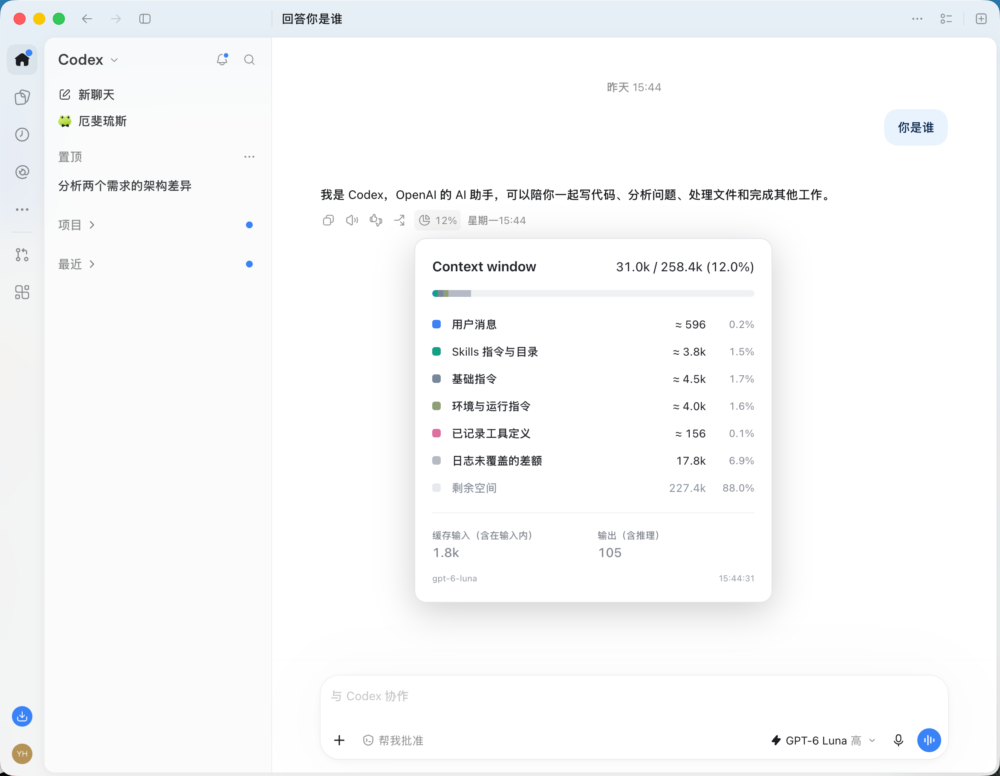

<p align="center">
  
</p>

<h1 align="center">Codex Context Lens</h1>

<p align="center"><strong>在回复旁，看清上下文占用。</strong></p>

<p align="center">
  <a href="https://github.com/Cloudkkk/codex-context-lens/actions/workflows/ci.yml"></a>
  <a href="LICENSE"></a>
  
  
</p>

Context Lens 是一个用于 macOS Codex / ChatGPT 桌面端的第三方本地插件。它读取本机的 Codex 会话日志，在每条已完成回复的操作栏时间左侧显示上下文用量，并通过悬停面板展示分类汇总。

<p align="center">
  <a href="#安装与使用">安装与使用</a> · <a href="#更新">更新</a> · <a href="#常见问题">常见问题</a> · <a href="CONTRIBUTING.md">贡献</a>
</p>




## 功能

- **消息旁直接查看**：回复操作栏时间左侧的饼图图标与百分比，hover 查看、点击固定、Esc 关闭。
- **历史轮次回放**：每个入口对应自己的会话和轮次，旧回复显示当时的用量。
- **上下文分类**：用户消息、助手消息、工具调用与返回、Skills、基础指令、记忆指令、压缩摘要等。
- **压缩感知**：使用日志中的替换历史重建上下文，避免把压缩前的数字套到新窗口。
- **一键初始化**：通过插件设置入口启动监控，需要时自动正常退出、重开；Hook 仅用于可选的后续恢复。
- **多会话与多窗口**：共享一个监控进程，每个窗口独立按真实轮次关联日志；本次桌面运行初始化一次即可，切换聊天无需重复 Setup。
- **本地运行**：Python 标准库实现，只读 `~/.codex/sessions`，不需要额外服务或第三方 Python 依赖。

分类目前只展示汇总。详细条目的展开入口暂时关闭，待内容归因更清楚后再加入。

## 安装与使用

需要 macOS Codex / ChatGPT 桌面端；优先使用应用自带 Python，也兼容本机 Python 3.9+。

1. 在 [最新 Release](https://github.com/Cloudkkk/codex-context-lens/releases/latest) 下载 **`Context-Lens-0.3.5-macOS.pkg`**，双击完成安装。
2. 打开 Codex 的 Context Lens 插件详情，运行 **Setup** 初始化技能，等待提示和 codex 自动重启即可。
3. 重开后，鼠标hover assistant消息下方的饼图按钮即可查看 context 使用量。


注意⚠️：当前包尚未签名或公证，如果 macOS 阻止打开，需要在「系统设置 → 隐私与安全性」中允许。

安装器自动完成当前用户的文件放置、来源登记、插件安装与启用，不设置登录启动项。初始化入口使用官方 `onboardingSkill`，会由 Codex 执行一次设置会话，可能需要宿主的执行权限审批；不是自行添加的原生脚本按钮。[官方说明](https://developers.openai.com/plugins/build/plugins#add-an-onboarding-skill)


## 更新

下载新 `.pkg` 并安装，再在插件详情运行 Setup。安装器会整体替换自己的来源目录，避免残留旧清单；不会修改其他插件来源或自动信任 Hook。

查看版本变化见 [CHANGELOG.md](CHANGELOG.md)。

## 用量如何计算

**总量来自该轮最后一次请求的 `input_tokens`。** 全会话累计消耗包含历史请求，不能当作当前窗口占用；缓存输入属于输入的一部分，不重复相加。

**分类是日志可见文本的估算。** 当前采用字符启发式，不是模型 tokenizer 的精确分项。无法从日志恢复的工具定义、图片、加密块和估算误差统一显示为差额。

发生压缩后，插件使用 `compacted.replacement_history` 重建上下文。如果刚压缩但还没有新的请求用量，显示未知，而不沿用旧统计。

完整口径、匹配规则和实现结构见 [架构说明](docs/architecture.md)。

## 常见问题

### Hook 是否必须信任

首次初始化不依赖 Hook。`SessionStart` 只在后续新建或恢复本地聊天时补启动监控；想启用这种恢复能力，可在「设置 → Hooks」审核并信任。Hook 不会关闭或重启应用。

### 为什么还可能需要重新初始化

调试参数属于本次应用进程。完全退出后从普通入口启动应用，参数可能丢失；此时再次运行 Setup 即可自动重开。不保证首次设置后永久免重启，也不修改应用包或登录启动项。

### 已安装，但没有图标

入口默认隐藏。先完成初始化，然后将鼠标移到已完成、有用量记录的本地回复上。检查状态时可以使用插件维护技能；`attached` 只代表连接成功，不能代替实际 hover 验证。

| 状态 | 含义 |
| --- | --- |
| `initialization_required` | 需要运行 Setup 开放调试端口 |
| `waiting_for_tasks` | 等待初始化回复或其他可见本地任务结束 |
| `quitting_app` / `reopening_app` | 正常退出或带参数重开中 |
| `quit_cancelled` | 应用拒绝退出或未在 30 秒内退出，未强退 |
| `initialization_timed_out` | 等待任务超过 15 分钟，已取消本次重启 |
| `initialization_cancelled` / `restart_failed` | 初始化状态不明确或重开失败，请检查状态后重试 |
| `attached` | 监控已连接；按钮仍需能匹配日志轮次 |

### 数据口径与平台限制

请求总量来自日志，分类为可见文本估算。macOS 以外的桌面接入尚未支持。包含 Hook 的包当前不适用于官方公共插件目录，可通过 GitHub 分发。[官方规则](https://developers.openai.com/plugins/build/plugins#bundled-mcp-servers-and-lifecycle-hooks)

## 卸载

先在插件页关闭 Context Lens，或在源码目录运行 `stop`，再移除插件和来源：

```sh
python3 plugins/context-lens/cli.py stop
codex plugin remove context-lens@codex-context-local
codex plugin marketplace remove codex-context-local
```

会话日志不会被删除。卸载不会改变已经运行的桌面应用启动参数；完全退出后正常打开即可。

## 开发与贡献

```sh
git clone https://github.com/Cloudkkk/codex-context-lens.git
cd codex-context-lens
PYTHONDONTWRITEBYTECODE=1 PYTHONPATH=plugins/context-lens python3 -m unittest discover -s plugins/context-lens/tests -v
node --test plugins/context-lens/tests/test_matching.cjs
```

Python 测试覆盖日志读取、初始化重启状态、监控与安装回滚，JavaScript 测试覆盖消息匹配。CI 在 Linux 与 macOS 上运行合成数据测试；真实桌面挂载仍需要手动验证。

发布前运行 `python3 scripts/package.py` 生成手动 ZIP，macOS 上运行 `python3 scripts/build_macos_package.py` 生成 GUI 安装包。脚本只收录 Git 已跟踪文件，校验插件 manifest、hook 引用、运行文件与 marketplace 路径；CI 同样检查打包。

贡献流程见 [CONTRIBUTING.md](CONTRIBUTING.md)，安全边界与问题反馈见 [SECURITY.md](SECURITY.md)。

## 致谢与许可

- [Codex-Monitor](https://github.com/KevinKE93/Codex-Monitor)：本地 CDP 接入思路与消息 DOM 标记。
- [Context Window Inspector](https://github.com/androidZzT/context-window-inspector)：会话日志和上下文归因思路。
- [OpenAI Plugins documentation](https://developers.openai.com/plugins/build/plugins)：插件格式、marketplace 与 hook 规范。
- 感谢 [LINUX DO](https://linux.do) 社区。学 AI，上 L 站。

本仓库代码独立实现，采用 [MIT License](LICENSE)。
